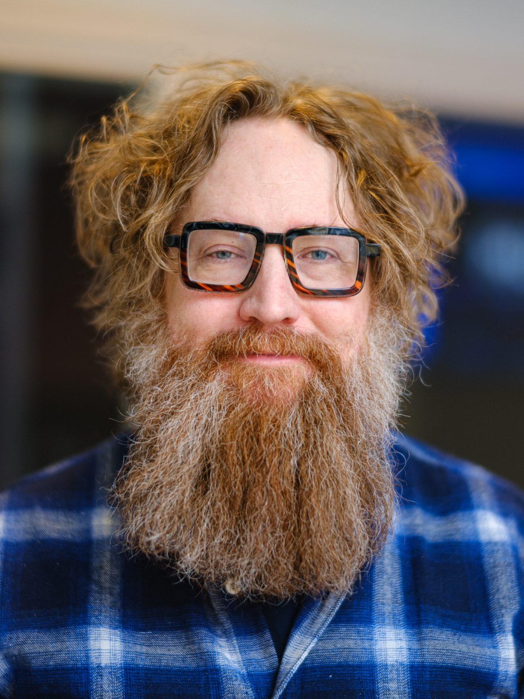
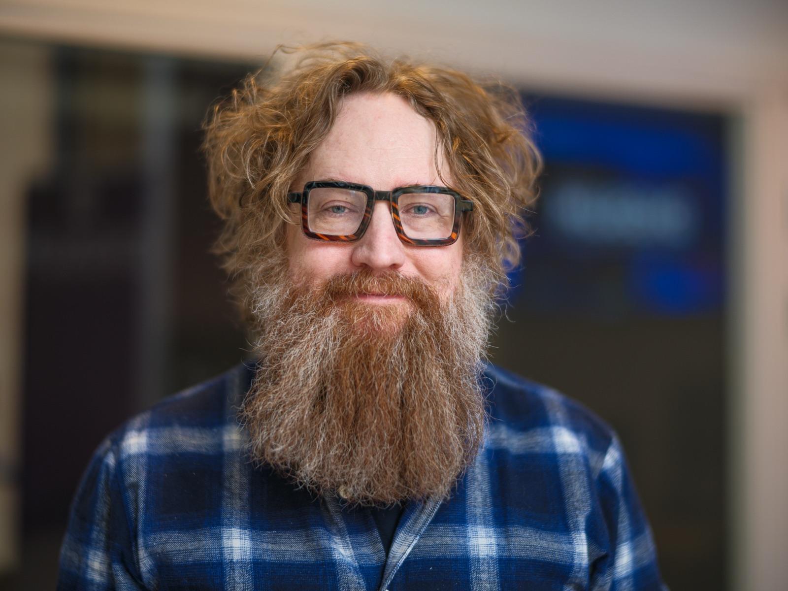
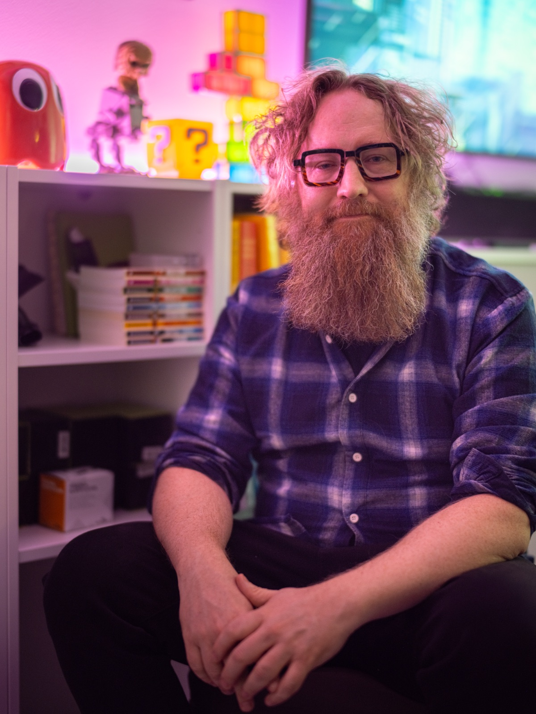
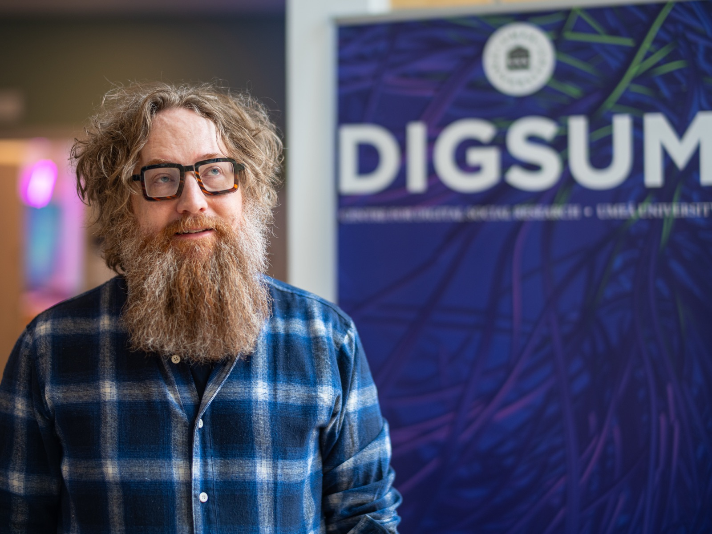

[<--back]({{ site.url }}/)

# Press photos

These photos of Simon Lindgren may be downloaded and used free of charge in connection with media coverage, talks, events and similar purposes. The photographer must be credited whenever a photo is used, in print as well as online.

Photo: <a href="https://www.naarttijarvi.com/">Markus Naarttijärvi</a>

The credit line should accompany any use of the images. The preview images below are reduced in size. The download links give the full resolution files.

  <figure>
    
    <figcaption>
      <strong>Portrait</strong> 
      3000 x 4000 px, 9.9 MB, JPEG 
      <a href="/assets/media/simon-lindgren-03-portrait.jpg" download="simon-lindgren-portrait.jpg">Download full resolution</a>
    </figcaption>
  </figure>

  <figure>
    
    <figcaption>
      <strong>Portrait, landscape</strong> 
      4000 x 3000 px, 7.4 MB, JPEG 
      <a href="/assets/media/simon-lindgren-02-portrait-landscape.jpg" download="simon-lindgren-portrait-landscape.jpg">Download full resolution</a>
    </figcaption>
  </figure>

  <figure>
    
    <figcaption>
      <strong>Office</strong> 
      3000 x 4000 px, 8.0 MB, JPEG 
      <a href="/assets/media/simon-lindgren-01-office.jpg" download="simon-lindgren-office.jpg">Download full resolution</a>
    </figcaption>
  </figure>

  <figure>
    
    <figcaption>
      <strong>DIGSUM</strong> 
      4000 x 3000 px, 7.0 MB, JPEG 
      <a href="/assets/media/simon-lindgren-04-digsum.jpg" download="simon-lindgren-digsum.jpg">Download full resolution</a>
    </figcaption>
  </figure>

All photos: Markus Naarttijärvi, <a href="https://www.naarttijarvi.com/">naarttijarvi.com</a>.
